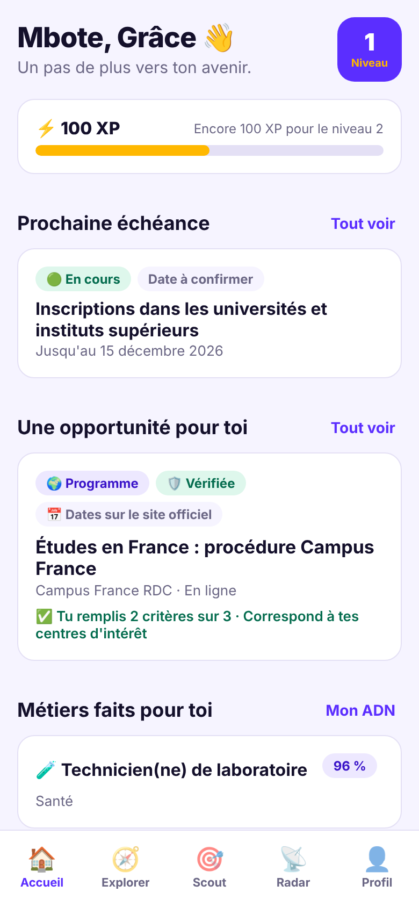
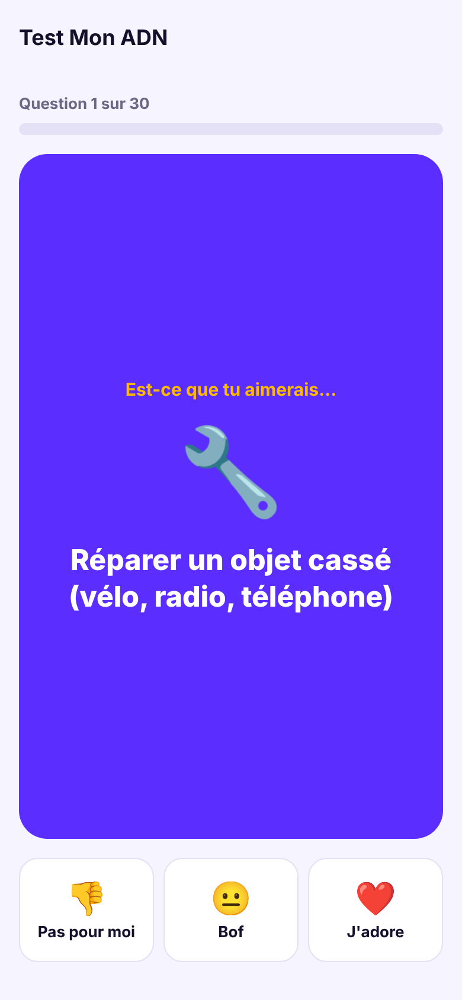
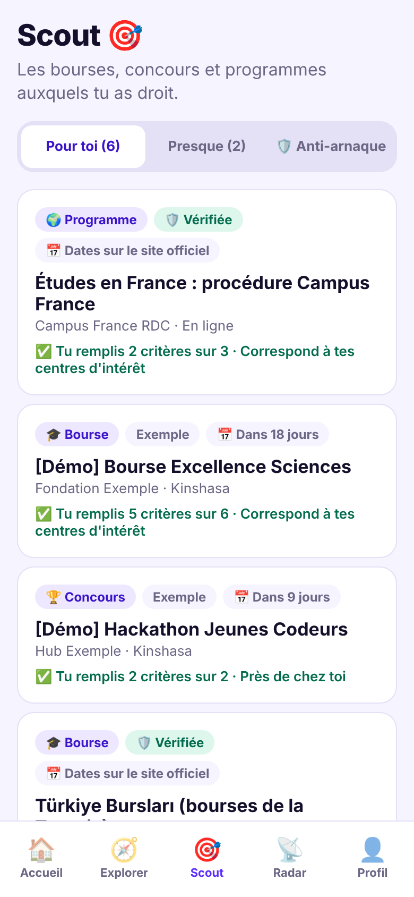
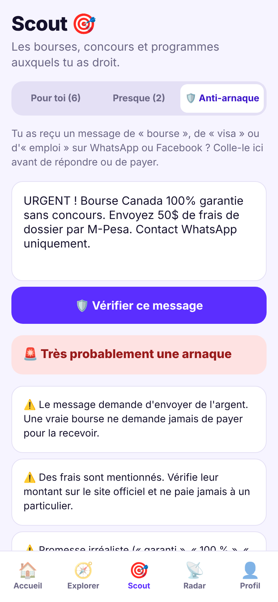

# Kesho (nom de code : Process)

> **Ton avenir commence aujourd'hui.** L'application qui accompagne chaque jeune, de l'école primaire jusqu'à son premier emploi.

## Dans ce dépôt

- [`mobile/`](mobile/) : l'application mobile (Expo, Android et iOS)
- [VISION.md](VISION.md) : la vision complète du projet
- [docs/PLAN-ACTION.md](docs/PLAN-ACTION.md) : ce qui est construit, les prochains sprints, les décisions à prendre
- [docs/SCOUT.md](docs/SCOUT.md) : le moteur d'opportunités
- [docs/FLUX-VIDEO.md](docs/FLUX-VIDEO.md) : vidéos natives, YouTube et TikTok
- [docs/SOLIDARITE.md](docs/SOLIDARITE.md) : le programme pour les enfants démunis
- [docs/MODELE-ECONOMIQUE.md](docs/MODELE-ECONOMIQUE.md) : revenus et estimation mensuelle
- [docs/CONCURRENCE.md](docs/CONCURRENCE.md) : concurrents en RDC, en Afrique et dans le monde
- [docs/PARTENAIRES.md](docs/PARTENAIRES.md) : partenaires à démarcher et pitchs

L'API est dans le dépôt `Process-bakend`.

## Aperçu

| Accueil | Test Mon ADN | Scout | Anti-arnaque |
|---|---|---|---|
|  |  |  |  |
